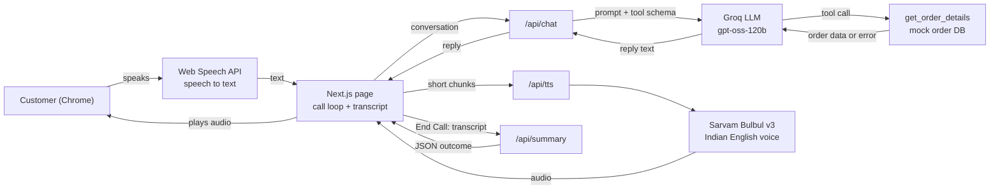

# Aria: AI Voice Support Agent for Aura Skincare

A browser-based voice customer support agent for a fictional D2C skincare brand. Click **Start Call**, talk to Aria, get answers on policies and live order status, and see a transcript with a structured JSON summary when the call ends.

**Live demo:** https://aura-voice-agent-4mi5.onrender.com (use Google Chrome and allow the microphone)

> First load may take up to a minute because free hosting wakes from sleep.

## Features

- Voice conversation in the browser (no telephony needed)
- Live state indicator: Listening, Thinking, Speaking
- Brand policy answers: shipping, returns, cancellation, COD
- Order lookup through LLM tool calling (`get_order_details`)
- Guardrails: refuses out-of-policy requests and out-of-scope topics, never invents products or prices
- Graceful handling of unknown or missing order IDs and unclear audio
- Hinglish replies when the customer speaks Hinglish
- Post-call transcript and JSON outcome
- Test Orders panel with sample IDs and suggested phrases
- Typed-message fallback if the microphone is unavailable

## Architecture



**One turn of the call**

1. The customer speaks; the browser transcribes it (Web Speech API, en-IN) and shows live captions
2. `/api/chat` sends the history plus the system prompt (persona, policies, known products, rules) to the LLM
3. If the question is about an order, the LLM calls `get_order_details`; the server runs it and returns the order or a structured error
4. The LLM writes a short spoken reply; the server cleans the text
5. The reply is split into short chunks, each synthesised by `/api/tts` in parallel, and played in order so the first chunk starts early
6. If TTS fails, the browser's built-in voice speaks instead
7. On End Call, `/api/summary` turns the transcript into a JSON outcome shown on the page

**Project structure**

```
app/
    page.js              call UI, listen/think/speak loop, transcript, summary
    api/chat/route.js    LLM + tool-calling loop
    api/tts/route.js     Sarvam text-to-speech proxy
    api/summary/route.js post-call JSON outcome
lib/
    prompt.js            persona, policies, product list, guardrails
    orders.js            mock order database + get_order_details
```

- **Frontend:** Next.js (App Router), one page that runs the listen, think, speak loop and holds the transcript
- **`/api/chat`:** builds the prompt (persona, policies, product list, rules), runs the tool-calling loop, returns the reply
- **`/api/tts`:** server-side proxy to Sarvam TTS so the API key never reaches the browser
- **`/api/summary`:** turns the transcript into a structured JSON outcome

### How the agent decides to use a tool

The system prompt requires a lookup for any order-specific question. The model is given the `get_order_details` schema and decides on its own when to call it. The server runs the function, returns the result (or a structured error such as `ORDER_NOT_FOUND` or `MISSING_ORDER_ID`) to the model, and the model words the answer naturally.

### How guardrails work

- Policies and the full list of known products are written in the system prompt
- The prompt forbids inventing products, prices, discounts or exceptions, and requires declining out-of-scope requests
- Order-based decisions (for example cancellation) are checked against the order status returned by the tool, never against the model's guess
- Tool errors are returned as data, so the model asks the customer to verify the ID instead of guessing

## Setup

```bash
git clone https://github.com/Ritikalodhi/aura-voice-agent.git
cd aura-voice-agent
npm install
cp .env.example .env.local   # on Windows: copy .env.example .env.local
# fill in GROQ_API_KEY and SARVAM_API_KEY
npm run dev
```

Open http://localhost:3000 in Chrome.

| Variable | Purpose |
|---|---|
| `GROQ_API_KEY` | LLM inference (Groq) |
| `GROQ_MODEL` | Model name, default `openai/gpt-oss-120b` |
| `SARVAM_API_KEY` | Text-to-speech (Sarvam Bulbul v3) |
| `SARVAM_SPEAKER` | Voice, default `ritu` |
| `SARVAM_LANG` | TTS language code, default `en-IN` |

Without `SARVAM_API_KEY` the app still works using the browser's built-in voice.

## Test orders

| ID | Status | Try saying |
|---|---|---|
| ORD-101 | Out for Delivery | "Where is my order ORD-101?" / "Cancel it" |
| ORD-102 | Delivered 14 days ago | "Can I return ORD-102?" |
| ORD-103 | Processing | "Cancel ORD-103" |

Other things to try: "Book me a flight to Goa", "Track ORD-999", "I opened a product 20 days ago, can I return it?", "Can I pay COD for 3000 rupees?"

## Known limitations

- Speech recognition uses the browser Web Speech API, which works in Chrome only
- No barge-in yet: Aria finishes her sentence before listening again
- Order data is a mock in-memory object
- Speech recognition is set to Indian English, so Hindi or Hinglish speech may be transcribed less accurately (Aria can still reply in Hinglish)
- Hosted on a free tier, so the first request after idle can take up to a minute

## Tell us how you think

### 1. Why did you choose your architecture and stack?

I used a modular STT, LLM, TTS pipeline instead of a realtime speech-to-speech API. It makes each step visible and debuggable: I can read exactly what the customer said, see which tool the model called, and control what is spoken. That matters for guardrails and the transcript. Next.js lets one repo hold the UI and the API routes, and it deploys as a single service (hosted on Render). Groq gives fast LLM inference with function calling and a free tier. Sarvam Bulbul gives a natural Indian-accent voice that handles Hinglish. The browser Web Speech API keeps speech recognition free and low-friction for a prototype, and every provider sits behind a small API route so it can be swapped.

### 2. What was the most difficult part, and how did you solve it?

Making the agent trustworthy. In testing, when I asked for "all your products", Aria invented a product catalogue and prices that did not exist in the brief. The fix was to ground the prompt with the only products we know, forbid inventing anything outside the prompt or tool results, and add test questions for these cases. A second challenge was making the call feel smooth: browser speech was robotic and slow. I moved to server-side Indian TTS, split replies into short chunks that are synthesised in parallel so the first chunk starts early, and added a browser-voice fallback so a TTS failure never breaks the call. I also hit a retired LLM model during development, so the model name is now an environment variable.

Another issue I found while testing the live app: customers say "order 101", not "ORD-101", and the agent kept asking for the exact format. I fixed it by normalising spoken numbers in the lookup function (so "101" and "one zero one" both map to ORD-101), telling the model never to ask for a specific ID format, and asking a clarifying question when a bare number could mean anything.

### 3. If you had one more week, what would you improve first?

Barge-in and turn-taking. Today the agent finishes speaking before it listens, which feels unlike a real call. I would move to streaming speech recognition with voice activity detection so the customer can interrupt, stop the audio instantly, and so the agent starts replying as soon as the customer stops talking. That improves the natural feel more than any other change. Next would be better Hinglish speech recognition and an automated test suite of policy and hallucination conversations.

### 4. What would change at 1,000 conversations a day?

- **Latency and cost:** stream the LLM output into TTS sentence by sentence, run STT on a streaming provider, and cache common phrases such as the greeting
- **Reliability:** provider fallbacks and retries, rate-limit handling, and timeouts so a slow API never leaves a customer in silence
- **Real data and security:** replace the mock orders with a real order service, verify the caller before sharing order details (for example OTP or phone match), and protect personal data in logs
- **Quality:** log every call with tool calls and outcomes, run automated evaluations on policy and hallucination cases, and review failed or low-confidence calls
- **Human handoff:** escalate to a person when the agent cannot resolve something or the customer is upset
- **Scale:** move from browser-based STT to a server-side media pipeline (for example WebRTC or telephony) so quality does not depend on the customer's browser

## Approach note

Aria is a browser voice agent built as an STT, LLM with tool calling, and TTS pipeline on Next.js. The model answers from a grounded prompt of policies and known products, calls a `get_order_details` tool for live order data, and a Sarvam Indian voice speaks the reply. After each call the app shows the transcript and a structured JSON summary.